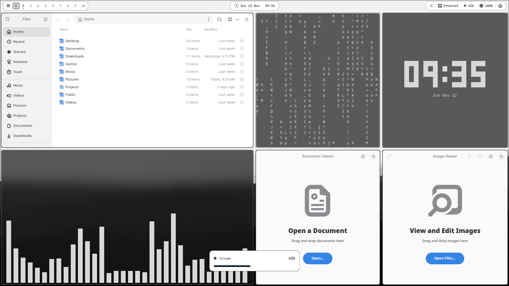
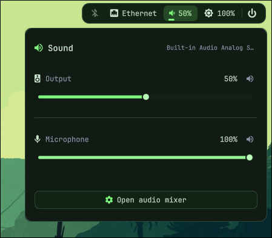
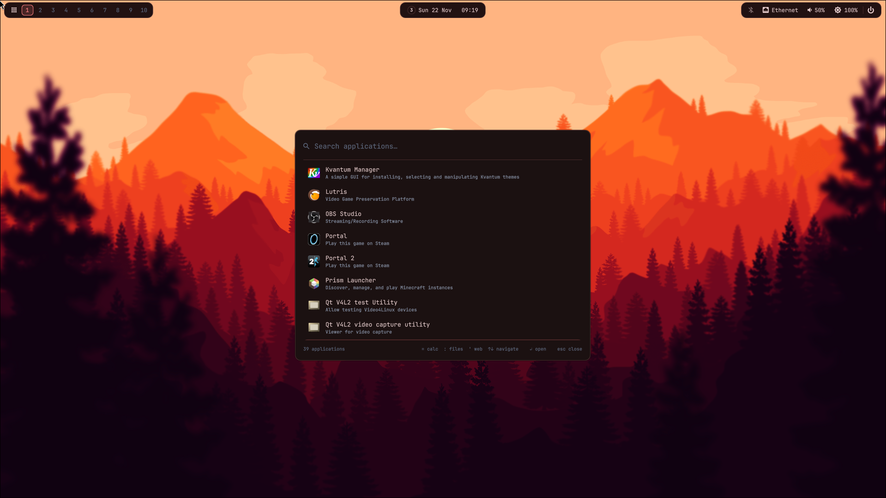
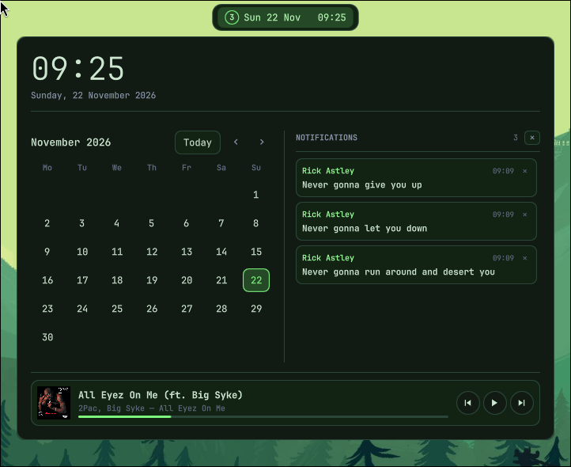
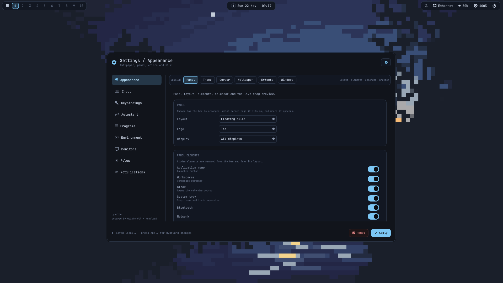
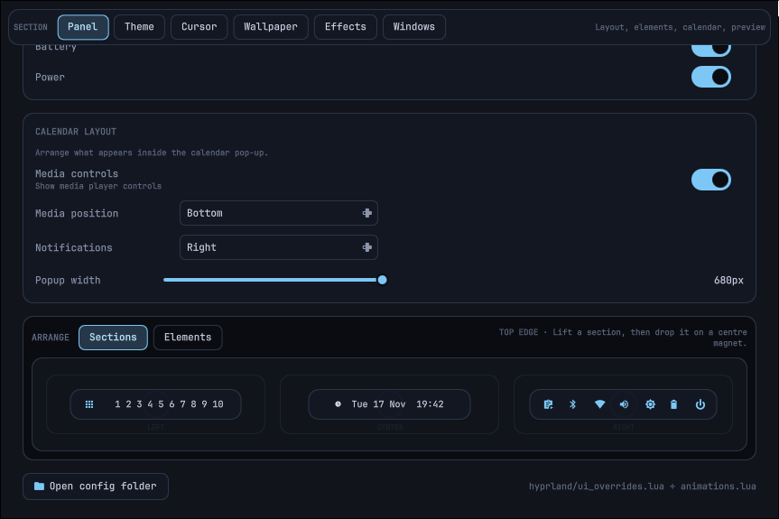
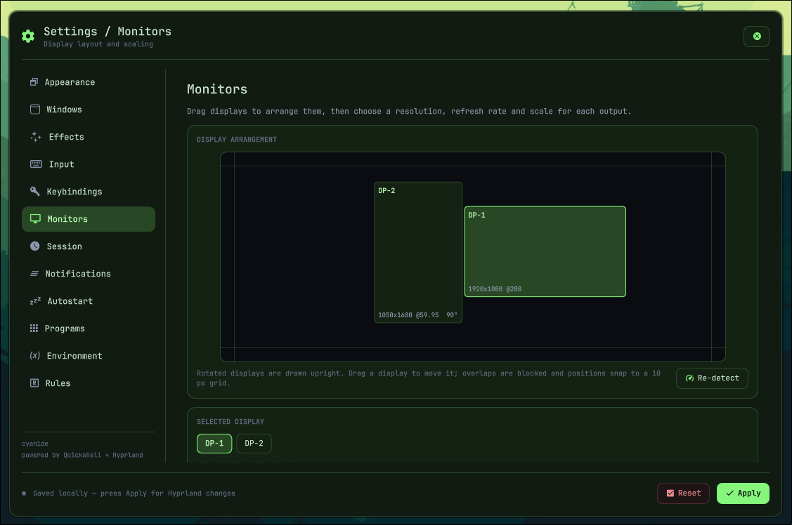
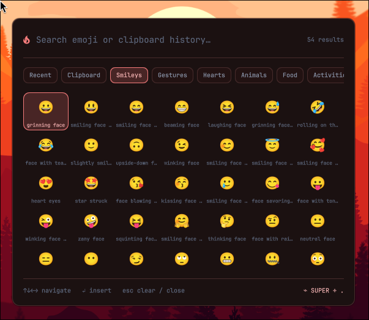
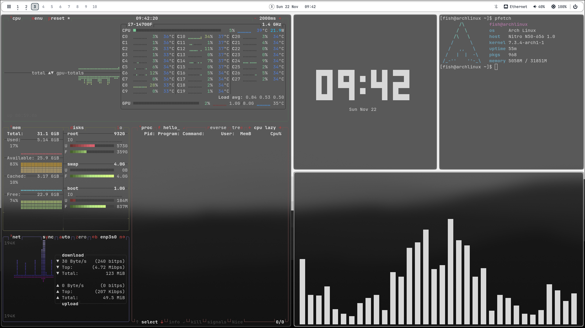

# cyan1de

A clean, dark, portable **Hyprland + Quickshell** desktop configuration for Arch-based systems. It ships with floating pill panels, a full graphical settings app, a launcher, emoji picker, notification history, OSD, lockscreen, and sensible default applications.

The shipped defaults use JetBrainsMono Nerd Font, a dark surface palette, and a blue-to-teal window-border gradient. Quickshell surfaces are opaque for crisp text; blur is limited to Hyprland windows and Alacritty.



*Default desktop with the shipped panel and applications.*

---

## Highlights

- Floating **pills**, continuous **unified**, or edge-reveal **island** panel modes
- Panel on **top / bottom / left / right**, on **all displays** or one selected monitor
- Ten workspaces, scratchpad, floating-window controls, and per-monitor fullscreen bar hiding
- Centered clock, system tray, Bluetooth, network, volume, brightness, battery, and power controls
- Software-brightness monitors dim the panel, topbar popups, other popups and cursor without affecting DDC-controlled displays
- Calendar popup with media controls and notification history
- Notification banners with hover pause, history, low-battery warnings, and configurable placement
- App launcher with application, file, and web-search actions
- Emoji picker with search and clipboard paste
- On-screen display for volume, brightness, keyboard brightness, and night light
- Lockscreen with a crash watchdog
- Graphical settings app that rewrites the managed Hyprland Lua files
- No Quickshell blur layers; Hyprland blur and Alacritty blur remain configurable

---

## Requirements

This is designed for **Arch Linux** or a derivative because `install.sh` installs packages with `pacman`.

The installer handles packages such as:

- `hyprland`, `quickshell`, `alacritty`
- `nautilus`, `firefox`, `gnome-text-editor`, `loupe`, `papers`
- `xdg-desktop-portal-hyprland`
- `brightnessctl`, `ddcutil`, `hyprshot`, `hyprsunset`, `hypridle`
- `playerctl`, `power-profiles-daemon`, `fprintd`
- `bluez`, `bluez-utils`, `networkmanager`
- `pipewire`, `wireplumber`
- `qt6ct`, `adw-gtk-theme`
- `ttf-jetbrains-mono-nerd`, `noto-fonts-emoji`
- `python`, `xdg-utils`, `ripgrep`, `wl-clipboard`

You can decline package installation and install them yourself.

---

## Installation

Download or clone this folder, then run the installer:

```bash
cd cyan1de
chmod +x install.sh
./install.sh
```

The installer:

1. Backs up existing `~/.config/hypr` and `~/.config/quickshell` directories with a timestamp.
2. Optionally installs the required packages with `pacman`.
3. Sets default apps only when their desktop files are present.
4. Best-effort enables `fprintd.service`, `bluetooth.service`, and `power-profiles-daemon.service`.
5. Copies `config/hypr` and `config/quickshell` into `~/.config`.
6. Makes all shipped Quickshell helper scripts executable.

After installation, reload Hyprland or log out and back in.

To remove the installed config directories later, run `./install.sh` and choose **Remove**. This does not uninstall packages.

---

## Default applications

The installer sets these defaults when available:

| Type | Application |
| --- | --- |
| File manager | Nautilus |
| Text editor | GNOME Text Editor |
| Image viewer | Loupe |
| PDF viewer | Papers |
| Browser | Firefox |


*The default applications and desktop layout are selected to work together out of the box.*

---

## Top bar

The default panel is a floating pill layout with the app menu and workspaces on the left, the clock centered, and system controls on the right. Open a control to reveal its popup; the active control gets a sliding highlight.



*The action section with quick system controls and popups.*

### Panel modes

Change this in **Settings → Appearance → Panel → Layout**:

| Mode | Behavior |
| --- | --- |
| `pills` | Separate floating pills for each group — default |
| `unified` | One continuous rounded panel with side margins |
| `unifiedCorners` | Unified bar attached flush to the screen corners |
| `unifiedWrap` | Unified bar plus a same-color frame around the other three screen edges, with every inner corner curved into the bar using Hyprland's window rounding radius |
| `island` | Compact panel that reveals near the selected screen edge |

The corners and wrap options are layout choices, not separate toggles. Existing configs that used the old **Unified bar + Corners on** combination are migrated to `unifiedCorners`, and configs saved with the earlier side-ramp option are migrated to `unifiedWrap` automatically.

The panel can sit on any edge and can follow all monitors or a single display. On left/right edges the clock shows a stacked date and time instead of a horizontal label.

The reserved bar area follows **Outer gaps**. Detached layouts keep one outer gap between the screen edge and the bar; attached layouts sit flush. In both cases the gap between the bar and window space matches the normal window outer gap.

With `unifiedWrap`, the frame genuinely acts as the display border: **Outer gaps** is applied between the wrap and the window space, so tiled windows sit one gap away from the bar on its edge and one gap away from the frame on the other three edges. The frame stays a fixed 7px wide, so the frame edges use `7 + Outer gaps` while the bar edge uses `Outer gaps` directly. New floating windows that Hyprland would centre in the usable area are centred in that window space instead. Layout, edge, display and **Outer gaps** changes refresh the window gaps immediately from Settings; **Apply** is still needed for other Hyprland settings. Per-side wrap gaps apply only in `unifiedWrap` when the panel follows all displays; a single-display filter keeps gaps uniform on the other monitors. Every other layout leaves `gaps_out` uniform, so the outer gap is measured from the real screen edge and no wrap frame is involved.

The bar hides automatically on a monitor when that monitor’s active workspace has a fullscreen window, so fullscreen video is not covered. Other monitors keep their bars.

---

## App launcher

Press **Super + Space** to open the launcher. It supports application search, file search, and web queries. Results can be launched directly or opened with the configured terminal and helper apps.



*Application launcher with search and actions.*

---

## Calendar and notifications

Click the clock to open the calendar. The popup can include media controls and notification history, and its layout and width are configurable in **Settings → Notifications → Calendar**.

Notifications support:

- top or bottom and left or right placement
- bubble duration and maximum visible count
- pause on hover
- optional persistent popups
- app icon and app name
- low-battery warnings
- notification history inside the calendar



*Calendar popup with notification history.*

---

## Settings app

Press **Super + comma** to open the settings app. It includes pages for:

- Appearance — wallpaper, panel, colors, and cursor
- Windows — borders, corner rounding, and gaps
- Effects — animations and blur
- Input — keyboard, pointer, touchpad, and gestures
- Keybindings — shortcuts and window actions
- Monitors — arrangement, scale, rotation, and refresh rate
- Session — idle dimming and screen lock
- Notifications — banners, history, calendar layout, and low-battery behavior
- Autostart — commands launched with Hyprland
- Programs — terminal, browser, file manager, and other defaults
- Environment — variables exported to applications
- Rules — window rules and per-app overrides

Hover any setting name for a short explanation of what it does. Ambiguous names such as **Layout** and **Sensitivity** have page-specific help text.



*The settings app home screen.*



*Grouped controls make appearance and behavior changes straightforward.*

### How settings are written

Settings live in `~/.config/quickshell/settings.json` for Quickshell and in Hyprland Lua files for compositor behavior.

Files managed by the settings app are rewritten when you press **Apply**:

- `input.lua`
- `programs.lua`
- `monitors.lua`
- `autostart.lua`
- `env.lua`
- `ui_overrides.lua`
- `animations.lua`
- `keybindings.lua`

Hand-edited files that Settings does not rewrite:

- `look_and_feel.lua`
- `permissions.lua`
- `rules.lua`

---

## Monitor configuration

The **Monitors** page can arrange displays, set scale and rotation, enable or disable outputs, and configure idle dimming and automatic lock timing.



*Monitor arrangement and display settings.*

---

## Emoji picker

Press **Super + period** to open the emoji picker. Search results can be copied to the clipboard or pasted into the focused application.



*Searchable emoji picker.*

---

## Window management

The default setup includes ten workspaces, a scratchpad, dwindle tiling, floating toggles, pseudo-tiling, split-direction toggling, and configurable window borders with a blue-to-teal gradient.



*Workspaces, borders, gaps, and window layout in use.*

---

## Default keybindings

`SUPER` is the main modifier.

| Shortcut | Action |
| --- | --- |
| `Super + Return` | Open terminal |
| `Super + Q` | Close window |
| `Super + E` | Open file manager |
| `Super + V` | Toggle floating state |
| `Super + Space` | Open app launcher |
| `Super + P` | Pseudo-tile window |
| `Super + J` | Toggle split direction |
| `Super + W` | Open browser |
| `Super + L` | Lock screen |
| `Super + comma` | Open settings |
| `Super + period` | Open emoji picker |
| `Super + Ctrl + P` | Toggle performance mode |
| `Super + 1` … `Super + 0` | Focus workspace 1–10 |
| `Super + Shift + 1` … `Shift + 0` | Move window to workspace 1–10 |
| `Super + F` | Toggle scratchpad |
| `Super + Shift + F` | Move window to scratchpad |
| `Super + Arrow keys` | Focus neighboring window |
| `Super + mouse_down` / `mouse_up` | Cycle workspaces |
| `Super + left click` / `right click` | Drag or resize floating window |
| `Super + Shift + S` | Region screenshot to clipboard |
| `Super + Ctrl + Shift + S` | Full monitor screenshot |
| `Super + Ctrl + S` | Region screenshot to file |
| `XF86Audio*` | Volume, mute, and media controls |
| `XF86MonBrightness*` | Display brightness |
| `XF86KbdBrightness*` | Keyboard brightness |

Screenshots use `hyprshot`.

---

## Layout

```text
cyan1de/
├── install.sh
├── README.md
├── demopics/
└── config/
    ├── hypr/
    │   ├── hypridle.conf
    │   ├── hyprland.lua
    │   └── hyprland/
    └── quickshell/
        ├── background/
        ├── emoji/
        ├── launcher/
        ├── lockscreen/
        ├── notifications/
        ├── osd/
        ├── performance/
        ├── settings/
        ├── topbar/
        ├── welcome/
        └── settings.json
```

Quickshell runs as separate named sessions: `topbar`, `osd`, `launcher`, `emoji`, `background`, `settings`, `notifications`, and `welcome`, plus the lockscreen watchdog.

---

## Notes

- Use a Wayland session with Hyprland.
- JetBrainsMono Nerd Font and Noto Emoji are expected; without them, glyphs may fall back.
- Quickshell panels are intentionally opaque. The available blur options are **Hyprland blur** and **Alacritty blur** in Settings.
- If a panel looks wrong after upgrading, remove the old `~/.config/quickshell` and `~/.config/hypr` directories and reinstall; the installer backs them up first.
- Popup content uses a shared fixed size; the calendar has its own fixed height to keep month switching stable.
